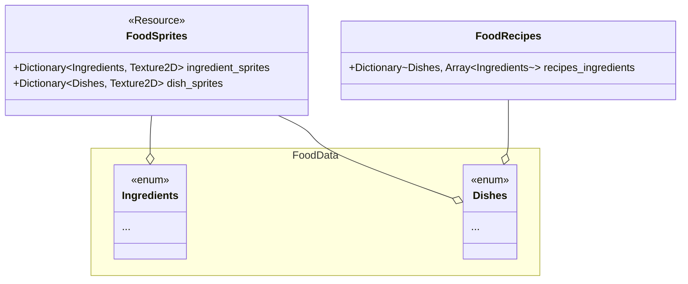

## Estructura de los datos

### Ingredientes y recetas
Primeramente, usaremos un enum para almacenar una lista directa de los ingredientes:

Se implementarán en GDScript debido a que C# no permite exportar genéricos, los cuales eran nececsarios para usar nuestro `DynamicArray`.
