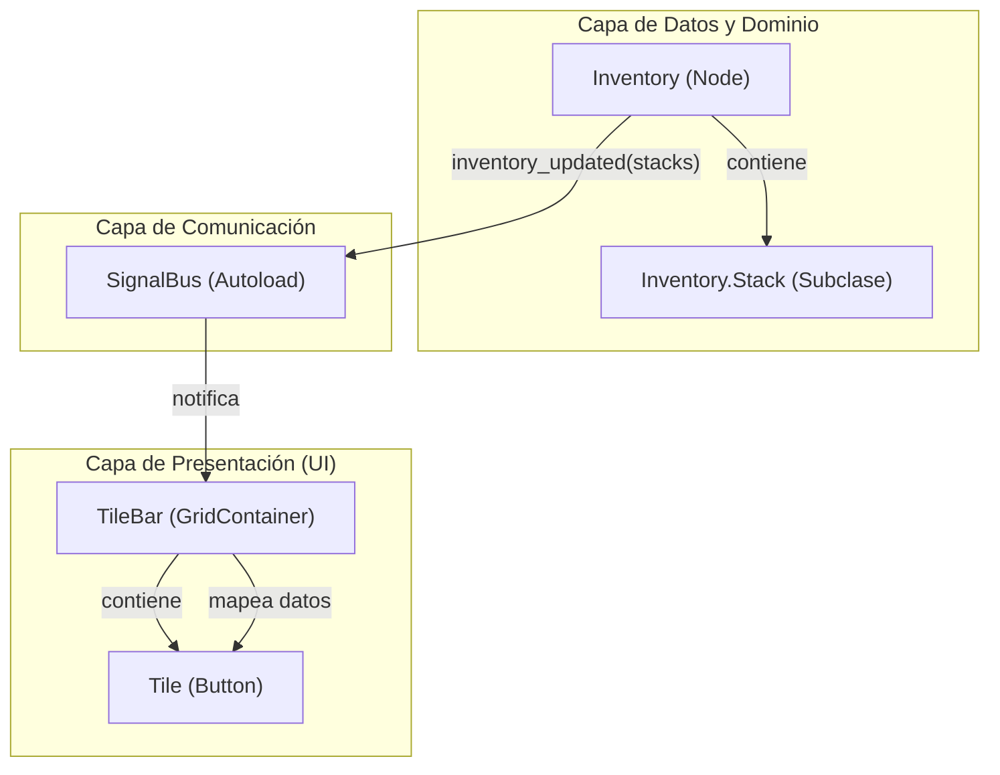

# Arquitectura del Sistema de Inventario

El sistema está diseñado bajo el patrón **Modelo-Vista (MV)** desacoplado mediante eventos reactivos.

---

## Diagrama de Arquitectura

---

## Responsabilidades por Componente

| Capa | Componente | Tipo | Responsabilidad |
| :--- | :--- | :--- | :--- |
| **Dominio** | `Inventory.Stack` | Clase interna | Unidad atómica de almacenamiento. Define la capacidad máxima de apilamiento (`MAX_SIZE`), tipo de ingrediente y conteo. |
| **Dominio** | `Inventory` | `Node` | Único dueño del estado del inventario. Administra la colección de `Stack`, valida reglas de capacidad y expone la API de modificación (`push`, `pop`). |
| **Canal** | `SignalBus` | Autoload global | Desacopla la lógica del juego de la interfaz. Emite cambios de estado sin que el dominio conozca a la UI. |
| **Vista** | `TileBar` | `GridContainer` | Contenedor de interfaz. Gestiona el ciclo de vida de los casilleros visuales (`Tile`) y sincroniza su cantidad e índices con el estado recibido. |
| **Vista** | `Tile` | `Button` | Elemento visual pasivo. Recibe valores planos (`ingredient`, `count`) y actualiza su icono y etiqueta numérica . |

---

## Flujo de Datos
1. **Mutación:** Un actor externo invoca `push()` o `pop()` en `Inventory`.
2. **Notificación:** `Inventory` aplica los cambios en sus `Stack` y publica el arreglo resultante a través de `SignalBus.inventory_updated`.
3. **Renderizado:** `TileBar` escucha el evento y transfiere directamente los valores a sus casillas `Tile` hijas.
